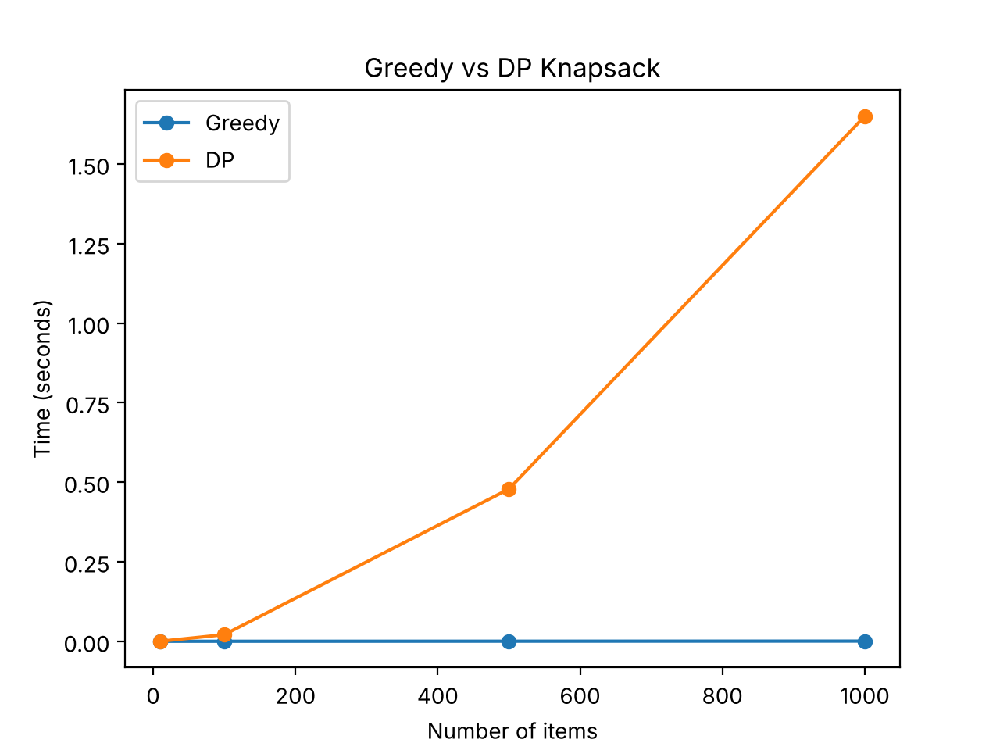

# Intelligent Inventory Management Using Knapsack Optimization

## Problem Statement
A warehouse manager has limited storage capacity. Each product has a weight and a profit.
The goal is to select products so that total profit is maximum without exceeding the capacity.

## Algorithms Implemented
| Approach | Algorithm | Can split an item? |
|----------|-----------|--------------------|
| Greedy | Fractional Knapsack | Yes |
| Dynamic Programming | 0/1 Knapsack | No |

## How to Run

### Option A: Web Dashboard (recommended)
```bash
pip install -r requirements.txt
python app.py
```
Open http://127.0.0.1:5000 in the browser. The dashboard lets you add or remove products,
set the capacity, run both algorithms, see selected items, profit charts and a performance test.

### Option B: Command line
```bash
python main.py
```
Menu options: (1) sample data, (2) custom input, (3) performance comparison, (4) exit.

## Project Structure
```
inventory-knapsack/
├── README.md
├── app.py             # Flask backend (dashboard APIs)
├── templates/
│   └── index.html     # Dashboard page (HTML, CSS, JS, Chart.js)
├── main.py            # command line menu and performance comparison
├── algorithms.py      # Greedy and DP functions
├── requirements.txt
└── results/
    ├── comparison.csv
    └── comparison_graph.png
```

## Dashboard API
| Route | Method | Purpose |
|-------|--------|---------|
| `/` | GET | Shows the dashboard page |
| `/api/solve` | POST | Takes items and capacity, runs Greedy and DP, returns profit, time and selected items |
| `/api/performance` | GET | Runs both algorithms on 10, 100, 500, 1000 items and returns timings |

## Complexity
| Algorithm | Time | Space |
|-----------|------|-------|
| Fractional Knapsack (Greedy) | O(n log n) (sorting) | O(n) |
| 0/1 Knapsack (DP) | O(n x W) | O(n x W) |

n = number of items, W = capacity.

## Results (sample run)
| Items | Greedy time (s) | DP time (s) | Greedy profit | DP profit |
|-------|-----------------|-------------|---------------|-----------|
| 10    | 0.000019 | 0.000165 | 336.62  | 331   |
| 100   | 0.000078 | 0.020814 | 4565.33 | 4558  |
| 500   | 0.000303 | 0.478613 | 21012.82 | 21012 |
| 1000  | 0.000594 | 1.650378 | 41298.78 | 41298 |



## Conclusion
- Greedy is much faster, but it assumes items can be split, so it is not always practical.
- DP is slower but gives the correct answer when items cannot be split (real warehouse boxes).
- Greedy profit is always >= DP profit because splitting gives extra flexibility.
